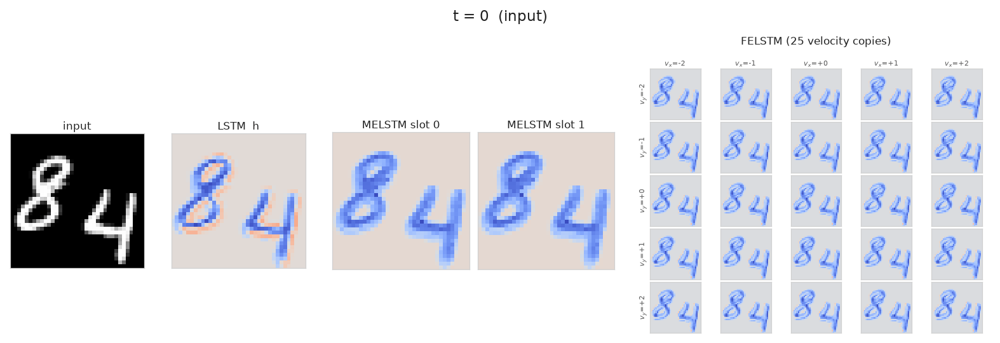
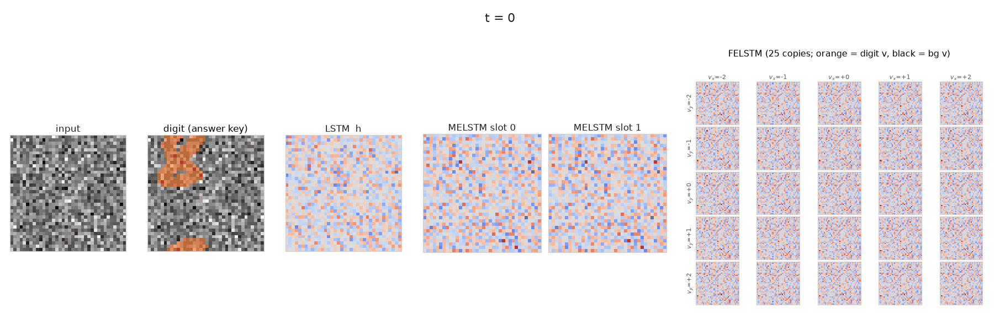

<h1 align="center">MELSTM</h1>

<p align="center">
  <b>Motion Equivariant Convolutional LSTM: When Motion Becomes a Gauge Symmetry</b>
</p>

<p align="center">
  Paper: coming soon on arXiv &nbsp;·&nbsp;
  <a href="#quick-start">Quick start</a> &nbsp;·&nbsp;
  <a href="#citation">Citation</a> &nbsp;·&nbsp;
  <a href="LICENSE">MIT License</a>
</p>

<p align="center">
  
</p>
<p align="center"><sub>
Two digits on sine-shaped paths. Left to right: the input, the ConvLSTM's memory, MELSTM's two slots, and FELSTM's 25 velocity copies. The last ten frames are predicted.
</sub></p>

## Motion as a gauge symmetry

Shifting every frame of a video by the same amount is a global symmetry, and convolution respects it. A **motion** is a shift whose velocity changes in time: the same symmetry, made local in time. That makes it a gauge symmetry, with time as the base space.

MELSTM is built around that symmetry. A velocity estimate, from phase correlation, acts as the connection. The recurrent memory is parallel-transported along it before every update. The hidden state is then **motion equivariant**: moving the input by any motion moves the state by the same motion, at every step,

$$
H_t[\psi \triangleright X_{\le t}] = \psi_t \triangleright H_t[X_{\le t}] .
$$

Flow-equivariant RNNs ([FERNN](https://github.com/akandykeller/FERNN)) cover constant velocities only, and keep one copy of the memory per velocity. MELSTM keeps one state per moving object and covers any motion, with the same cell and the same parameters as a ConvLSTM.

## Experiments

**Moving MNIST.** Next-frame prediction of two digits whose velocities keep changing.

**Motion-Only MNIST (common fate).** A digit made of noise moves over moving noise, so only its motion reveals it.

<p align="center">
  
</p>

**KTH.** Action recognition while the camera shakes.

## Quick start

```bash
git clone https://github.com/VahidHosseinzadeh/MELSTM.git
cd MELSTM
pip install -r requirements.txt
```

`moving_mnist/train.py` logs to Weights & Biases. Set `WANDB_MODE=offline` to run it without an account.

```bash
# Moving MNIST (MNIST downloads on first use)
for m in lstm felstm melstm; do bash run_comparison.sh $m 42; done
python moving_mnist/motion_difficulty_sweep.py --model_save_dir ./experiments_ms42_base --download

# Motion-Only MNIST
for m in lstm felstm melstm; do bash run_classification.sh $m; done
python moving_mnist/motion_sweep_classification.py --download

# KTH (the prep script downloads KTH, about 1.2 GB)
python -m kth.prepare_kth
for m in lstm felstm melstm; do bash run_kth.sh $m 1; done
bash run_kth.sh sweep
```

Each run writes its checkpoints and histories to an `experiments_*` folder. FELSTM keeps 25 copies of its state and needs a large GPU (about 60 GB at the Moving MNIST settings).

## Repository

```
moving_mnist/
  velocity_model_based_MEConvLSTM_model.py   MELSTM
  channel_based_FEConvLSTM_model.py          FELSTM, and the ConvLSTM as its one-velocity case
  velocity_predictor_model.py                phase correlation
  time_dependent_moving_mnist_dataset.py     Moving MNIST with time-dependent motion
  common_fate_moving_mnist_dataset.py        Motion-Only MNIST
  train.py, train_classification.py          trainers
  motion_*.py                                motion sweeps
kth/                                         KTH data, camera motion, trainer and sweeps
motion_benchmarks/                           classifier helpers used by the KTH code
run_comparison.sh, run_classification.sh, run_kth.sh
```

## Citation

```bibtex
@article{hosseinzadeh2026melstm,
  title   = {Motion Equivariant Convolutional {LSTM}: When Motion Becomes a Gauge Symmetry},
  author  = {Hosseinzadeh, Vahid},
  journal = {arXiv preprint},
  year    = {2026}
}
```

## Acknowledgements

FELSTM and the KTH protocol follow [FERNN](https://github.com/akandykeller/FERNN). The KTH dataset is by Schuldt, Laptev and Caputo (ICPR 2004).
